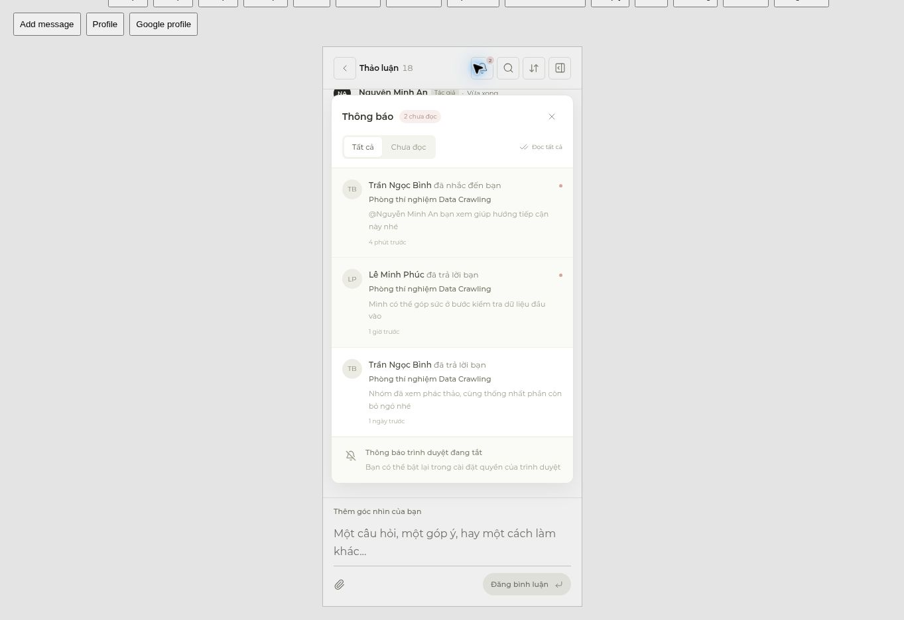

# Collaboration UI QA — 26 October 2026

The collaboration controls now use the existing IdeaHub type, spacing, neutral palette and rounded surfaces. The reported screenshot exposed native browser button borders, member IDs and overlapping mention/notification popups.

## Corrections

- Mentions: compact member list with avatars, selected-row feedback and desktop keyboard hints. Internal IDs are not displayed. Opening another surface dismisses the suggestions without deleting the draft.
- Notifications: consistent filter controls, unread badge, avatar/byline/excerpt hierarchy, clear empty/error/loading states and device-permission copy. Fixed a stacking-context bug discovered during browser QA where the chat covered the open panel. Mobile uses a constrained panel and outside-click scrim.
- Search: labelled sender filter, clear-query/filter actions, subtle accent-insensitive highlights, source navigation and dedicated empty/error/loading states. Closing mobile search resets its expanded state and restores the trigger.
- Editing: visible inline label, restrained editor container, pending/error feedback, preserved text on conflicts and fewer competing actions. Cancel/save restores keyboard focus. Failed-send recovery actions are hidden while revising the draft.
- Failed sends: readable error message and grouped retry/edit/copy/discard actions that wrap on narrow screens.
- Narrow headers: sorting becomes an icon at 400 px and below so notifications, search and room information remain visible at 320 px.

## Browser checks

Real React components were rendered in the isolated `tests/ui/preview.tsx` harness using mocked authenticated API/SSE/device-permission responses. No messages were sent to a production room.

| Area | Observed result |
| --- | --- |
| 320 px header | All controls inside the viewport; document width equals 320 px |
| 320/390 px notification panel | Panel is above chat, constrained to the viewport; filters and read-all work |
| Notification error/empty states | Retry affordance and explanatory copy render correctly; read-all transitions to the unread-empty state |
| 390/1440 px mentions | Compact list, no internal IDs/native borders; ArrowDown + Enter selects a member |
| Popup coordination | Opening notifications closes mentions and preserves the `@` draft; Escape closes the panel |
| 390/768 px search | `nguon` highlights `nguồn`; selecting a collapsed nested reply expands its ancestors and focuses the source |
| Inline edit conflict | Failed save keeps the edited content and displays the error; cancel restores the original comment |
| Failed send at 390 px | Error/actions fit; retry transitions through sending and reconciles with the same comment ID |
| New arrivals while scrolled upward | ScrollTop remained 3054 before/after a mocked SSE arrival; `1 tin mới` appeared; clicking it revealed and focused the new comment |

## Automated checks and limits

- TypeScript and production build pass.
- Full suite: 97 passed, 1 external PostgreSQL integration test skipped because its separate test connection was not configured.
- Production deployment smoke check covers homepage, persistent PostgreSQL, cursor pagination and anonymous rejection by the live-comments endpoint.
- Real operating-system push delivery and physical-device virtual-keyboard behavior were not exercised; device-permission UI was tested with fixtures.
- Generated `public/__qa_*` assets are temporary and excluded from the production tree. Reproduce with `npm run build && node tests/ui/build-preview.mjs`.

