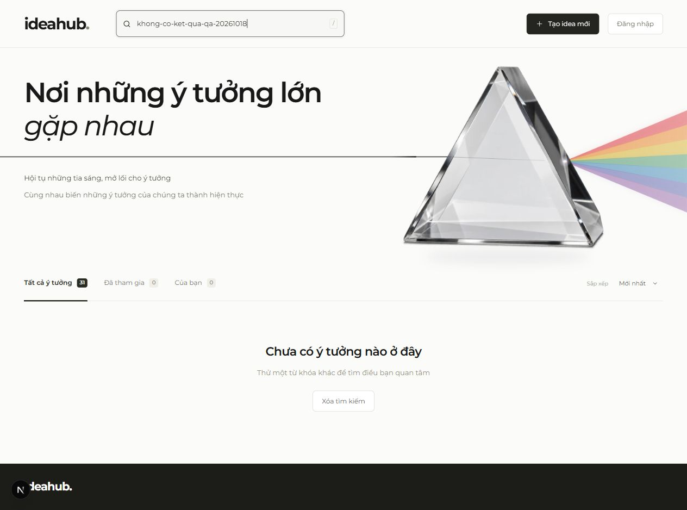
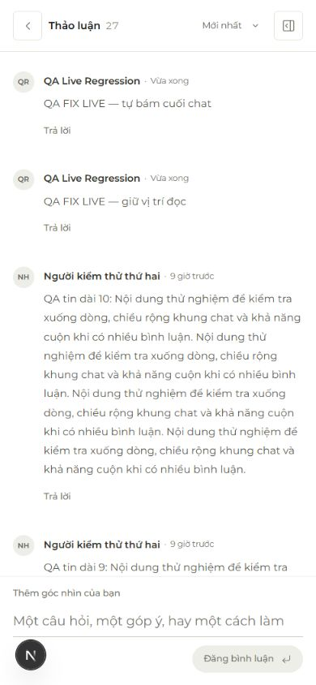

# Kiểm tra bản sửa QA — 18/10/2026

Bản sửa xử lý QA-01 đến QA-04 trong [báo cáo ban đầu](qa-2026-10-18.md). Không cần thay đổi schema PostgreSQL hoặc cấu hình dịch vụ.

| Lỗi | Thay đổi | Kết quả kiểm tra |
| --- | --- | --- |
| QA-01: tên hồ sơ bị ghi đè | Tạo idea/gửi bình luận chỉ thêm user chưa tồn tại; không cập nhật tên/initial của user đã có | PostgreSQL nhúng chạy migrations thật: lưu tên mới, sau đó tạo bình luận và idea bằng snapshot cũ; tên mới và initials vẫn giữ, tác giả trả về đúng tên mới |
| QA-02: phân trang trùng và thẻ rác | Dashboard dùng cursor thay cho offset và loại ID trùng trước khi render; thứ hạng popular và membership filter lấy tại mốc trang đầu | SQL và local: xen kẽ tạo idea/tham gia nhóm giữa các trang, không trùng/thiếu mục trong bộ dữ liệu kiểm thử; kiểm tra thêm timestamp trùng, độ chính xác microsecond, cursor khác truy vấn, truy vấn rỗng |
| QA-03: đổi thứ tự nhưng giữ cuộn cũ | Khi người dùng đổi thứ tự, đưa khung bình luận về đầu danh sách mới; cập nhật live vẫn giữ hành vi theo vị trí đọc | Browser thật: đổi cả hai chiều đều `scrollTop=0`; đầu “Mới nhất” hiển thị tin mới nhất |
| QA-04: 127.0.0.1 từ chối request local | So sánh Origin với Host đích thực tế khi Next chuẩn hóa request URL; không lấy x-forwarded-host làm danh sách cho phép | Browser đăng ký thành công tại 127.0.0.1; test tiếp tục chặn origin khác, Sec-Fetch-Site cross-site và forwarded host giả |

## Bằng chứng browser

Ứng dụng Next chạy local với dữ liệu JSON; thao tác qua trình duyệt tích hợp của agent. Production chỉ kiểm tra đọc; không tạo tài khoản/bình luận QA lên production.

- Trang đầu có 24 thẻ trong tổng 30. Tài khoản HTTP độc lập tạo thêm một idea; bấm “Xem thêm”: đúng 30 thẻ, 30 ID riêng biệt, không lẫn idea mới vào đợt tải cũ. Tìm `khong-co-ket-qua-qa-20261018`: đúng 0 thẻ, status “0 ý tưởng”, không còn ghost card.
- Phòng dài 25 bình luận, đổi “Cũ nhất” sang “Mới nhất”: cuộn từ khoảng 1863px về 0; tin `QA tin dài 10` xuất hiện đầu khung. Đổi lại “Cũ nhất”: cuộn 0 và đúng bình luận đầu.
- Đang đọc đầu khung ở “Cũ nhất”, tài khoản thứ hai gửi tin: tổng 25 → 26, cuộn giữ 0. Di chuyển đến cuối rồi tài khoản thứ hai gửi thêm tin: tổng 26 → 27, khoảng cách tới đáy xấp xỉ 0px, không cần reload.
- Mobile viewport 390 × 845: chiều rộng document 390px, không tràn ngang; đổi “Mới nhất” cuộn về 0, hiển thị đúng tin vừa thêm.
- Không có console error trong tab kiểm tra.

## Kiểm tra tự động

- `npm run check`: TypeScript đạt; 50 test, 49 đạt, 1 bỏ qua, 0 lỗi. Bài kết nối PostgreSQL ngoài cần `TEST_DATABASE_URL` chưa cấu hình; các test PostgreSQL nhúng chạy đầy đủ.
- `npm run build`: build production và TypeScript đạt.
- Smoke sau deploy kiểm tra thêm API danh sách thực tế trên PostgreSQL production và tải trang cursor tiếp theo, bảo đảm hai trang không lặp ID; chỉ gửi GET.
- Kiểm thử sandbox đầu tiên gặp Windows EPERM khi rename file JSON tạm; chạy lại toàn bộ ngoài sandbox đã qua. Một fixture SQL cũ tạo user chỉ có tên placeholder đã được sửa để mô phỏng hồ sơ có sẵn như phiên đăng nhập thực tế.

## Phạm vi còn lại

Các đề xuất sản phẩm trong báo cáo cũ như sửa/xóa nội dung, rời nhóm, khôi phục mật khẩu, hiện tên phòng trên header và mở toàn bộ nguồn recap chưa nằm trong bản sửa bốn lỗi này. Giới hạn cron recap bốn file/lượt và mô hình SSE polling giữ nguyên; chưa có kiểm thử tải lớn. Cursor dùng mốc thời gian dữ liệu, không giữ transaction xuyên các HTTP request; giao dịch bắt đầu trước mốc nhưng commit muộn vẫn có thể xuất hiện sau. Client offset cũ vẫn được hỗ trợ nhưng không có tính ổn định của cursor mới.
